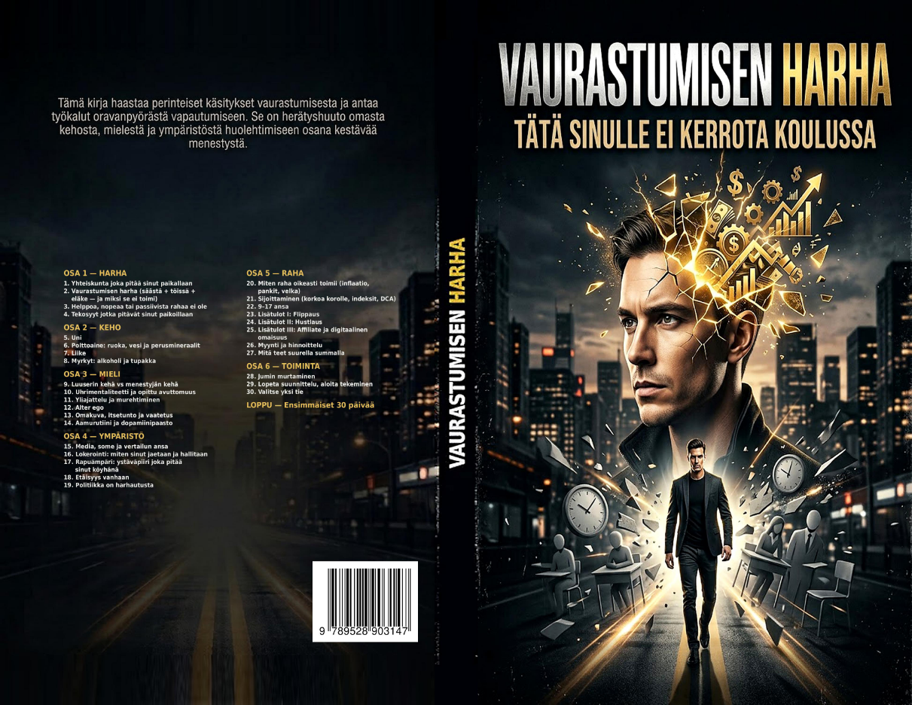

# Suorapuhe – Suomalainen blogi, joka sanoo asiat suoraan
> Kaunistelematonta faktaa yhteiskunnasta, terveydestä, rahasta, kryptovaluutoista ja mielenterveydestä. Herätys todellisuuteen – ota elämäsi haltuun.

🌐 **Sivusto:** [https://suorapuhe.github.io/suorapuhe/](https://suorapuhe.github.io/suorapuhe/)
📖 **Kirja:** [Tilaa painettuna 24,90 € (BoD)](https://kirjakauppa.bod.fi/vaurastumisen-harha-massikeimo-9789528903147)

---

## Mikä on Suorapuhe?

**Suorapuhe** on suomalainen blogi, joka tarjoaa selkeitä, tutkimukseen perustuvia näkemyksiä **terveydestä, taloudesta, kryptovaluutoista, mielenterveydestä ja itsensäkehittämisestä** – ilman kaunistelua. Sisältö on suunnattu suomalaiselle lukijalle, joka haluaa ottaa vastuun omasta elämästään, taloudestaan ja terveydestään.

Blogi kattaa kuusi pääkategoriaa: yhteiskunta, terveys ja liikunta, lisätulot, mediakritiikki, mielenterveys ja kryptovaluutta.

---

## 📖 Vaurastumisen harha – kirja

**Vaurastumisen harha** (ISBN 9789528903147) on kirja, joka purkaa myytin siitä, että palkkatyö ja säästäminen tekevät sinusta varakkaan. Kirja käsittelee mielenhallintaa, terveyttä, taloutta, sijoittamista, kryptovaluuttoja ja käytännön keinoja lisätulojen rakentamiseen.

- **Tilaa painettu kirja:** [kirjakauppa.bod.fi – 24,90 €](https://kirjakauppa.bod.fi/vaurastumisen-harha-massikeimo-9789528903147)
- **Kirjailija:** Massikeimo

---

## 🔥 12 viikon elämänmuutoshaaste (ilmainen)

Sivuston sisältö on koottu ilmaiseksi 12 viikon haasteeksi: mieli, keho ja raha kuntoon rinnakkain, 15–30 minuuttia päivässä. Lyhyt alkukartoitus asettaa tehtävät omalle tasolle, ja viikolla 5 valitaan lisätulorata – flippaus, hustlaus tai talouden perusteet. Edistyminen tallentuu vain käyttäjän omaan selaimeen.

- **Vaihe 1 – Herätys (vk 1–4):** ruutuaika, liike, uni, ruoka, menot, puskuri ja velat
- **Vaihe 2 – Rakentaminen (vk 5–8):** jumi, proteiini, treeni, epämukavuusalue, lisätulorata ja välimittaus
- **Vaihe 3 – Vauhti (vk 9–12):** alter ego, stressi, aika, ruokavalio, loppumittaus ja raha töihin

[→ Aloita haaste](https://suorapuhe.github.io/suorapuhe/haaste/)

---

## Kategoriat

| Kategoria | Aiheet |
|-----------|--------|
| [Yhteiskunta](https://suorapuhe.github.io/suorapuhe/yhteiskunta/) | Talousjärjestelmä, koulutus, pankit, Bovaer, yhteiskuntakritiikki |
| [Terveys ja liikunta](https://suorapuhe.github.io/suorapuhe/terveys-ja-liikunta/) | Ravinto, treeni, uni, vitamiinit, hormonit, palautuminen |
| [Lisätulot](https://suorapuhe.github.io/suorapuhe/lisatulot/) | Flippaaminen, hustlaus, sijoittaminen, affiliate, henkilöbrändi |
| [Mediakritiikki](https://suorapuhe.github.io/suorapuhe/mediakritiikki/) | Yksityisyys, anonymiteetti, digitaalinen ID, valvonta |
| [Mielenterveys](https://suorapuhe.github.io/suorapuhe/mielenterveys/) | Ahdistus, dopamiini, itsensäkehittäminen, ajatusmallit |
| [Kryptovaluutta](https://suorapuhe.github.io/suorapuhe/kryptovaluutta/) | Pörssit, lompakot, DeFi, verotus, turvallisuus |

---

## Suosituimmat artikkelit

- [Flippaaminen ilman rahaa – miten aloitat tänään](https://suorapuhe.github.io/suorapuhe/lisatulot/mita-on-flippaaminen-ja-miten-aloitat-tanaan-ilman-rahaa.html)
- [CEX-pörssit täydellisesti – krypto aloittelijalle](https://suorapuhe.github.io/suorapuhe/kryptovaluutta/cex-porssit-taydellisesti-kycsta-pankkitiliin-lompakoihin-ja-kryptoveroihin.html)
- [Sokeririippuvuus – miten sokeri tuhoaa terveytesi](https://suorapuhe.github.io/suorapuhe/terveys-ja-liikunta/sokeririippuvuus-miten-sokeri-tuhoaa-terveytesi-hitaasti-ja-mita-sille-pitaa-tehda.html)
- [Pankkien suuri kusetus – miksi säästötilisi syö rahasi](https://suorapuhe.github.io/suorapuhe/yhteiskunta/pankkien-suuri-kusetus-miksi-saastotilisi-syo-rahasi.html)
- [Anonyymi Linux – täydellinen opas yksityisyyteen verkossa](https://suorapuhe.github.io/suorapuhe/mediakritiikki/anonyymi-linux-taydellinen-opas-yksityisyyteen-ja-anonymiteettiin-verkossa.html)

---

## Aiheet ja avainsanat

Suomalainen itsensäkehittäminen · taloudellinen vapaus · vaurastuminen · sijoittaminen aloittelijalle · kryptovaluutta suomeksi · Bitcoin · Solana · DeFi · lisätulot · sivutulot · flippaaminen · hustlaus · henkilöbrändi · affiliate-markkinointi · terveys · ravinto · proteiini · D-vitamiini · kortisoli · uni · treeniohjelma · kotitreeni · mielenterveys · ahdistus · masennus · dopamiinipaasto · someriippuvuus · mediakritiikki · yksityisyys verkossa · digitaalinen ID · yhteiskuntakritiikki · Vaurastumisen harha · Massikeimo

---

## Yhteystiedot ja linkit

- 🌐 Sivusto: [suorapuhe](https://suorapuhe.github.io/suorapuhe/)
- 🛒 Osta kirja: [BoD-kirjakauppa](https://kirjakauppa.bod.fi/vaurastumisen-harha-massikeimo-9789528903147)
- 🔍 Haku: [suorapuhe.github.io/suorapuhe/haku.html](https://suorapuhe.github.io/suorapuhe/haku.html)

#### Tiedot
[Tietosuojaseloste](https://suorapuhe.github.io/suorapuhe/tietosuojaseloste.html) · [Käyttöehdot](https://suorapuhe.github.io/suorapuhe/kayttoehdot.html) · [Evästekäytäntö](https://suorapuhe.github.io/suorapuhe/evasteet.html)

---

© 2026 Suorapuhe – Suomalainen blogi, joka sanoo asiat suoraan.
